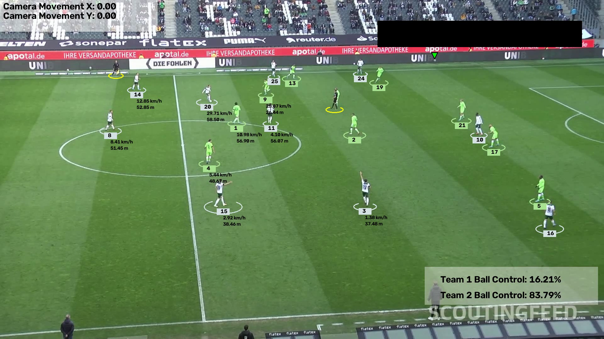
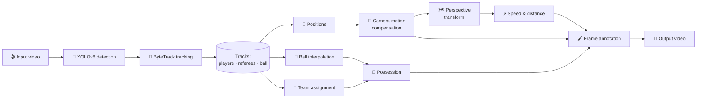

<div align="center">

# ⚽ Football Video Intelligence

**Broadcast footage in, tactical analytics out.**
Detection · Tracking · Team assignment · Camera-motion compensation · Speed & distance · Ball possession

<p>
  
  
  
  
</p>
<p>
  
  
  
  
  
  
</p>



<sub>Annotated output: team-coloured player markers with track IDs, referee and ball markers, possession bar, camera movement, live speed & distance.</sub>

</div>

---

## 📖 Overview

A computer-vision pipeline that turns raw broadcast football video into structured, frame-level analytics. It detects players, referees and the ball, tracks them across frames, compensates for camera motion, maps positions into field coordinates, estimates per-player speed and distance, assigns teams by jersey colour, and attributes ball possession over time.

> [!NOTE]
> Broadcast video is abundant, but raw pixels aren't actionable. Reliable tracking plus geometric normalisation bridges the gap between **video** and **analytics**: perception → tracking → transformation → features → rendered output.

## ✨ Features

| | Capability | How |
|---|---|---|
| 🎯 | **Detection** of players, goalkeepers, referees, ball | Ultralytics YOLOv8x @ 1280 px, batched GPU inference |
| 🔗 | **Multi-object tracking** with stable IDs | ByteTrack (Supervision), tuned to the video's frame rate |
| 🏀 | **Ball trajectory interpolation** | Most-confident ball per frame, gaps filled with pandas |
| 🎥 | **Camera motion estimation** | Sparse Lucas-Kanade optical flow |
| 🗺️ | **Perspective transform** | Homography from image plane to pitch metres |
| 👕 | **Team assignment** | KMeans clustering on jersey colours |
| 🤝 | **Ball possession** | Nearest-foot heuristic with distance threshold |
| ⚡ | **Speed & distance** | Per-player km/h and cumulative metres |
| 💾 | **Smart caching** | Stubs fingerprinted to the source video; stale caches are rebuilt automatically |
| 🪶 | **Low memory footprint** | Frames decoded lazily and streamed to the writer, not held in RAM |

## 🏗️ Architecture



## 🚀 Quick start

> [!TIP]
> This project uses [**uv**](https://docs.astral.sh/uv/). It installs Python 3.12, creates `.venv` and installs the locked dependencies in one step. On Windows/Linux it pulls the **CUDA 13.0** PyTorch build, so detection runs on an NVIDIA GPU when one is available.

```bash
# 1. Clone and install
git clone https://github.com/TrishamBP/football_analysis_yolo.git
cd football_analysis_yolo
uv sync

# 2. Fetch model weights + a sample DFL Bundesliga clip
uvx gdown -O models/best.pt "https://drive.google.com/uc?id=17PXFNlx-jI7VjVo_vQnB1sONjRyvoB-q"
uvx gdown -O data/test.mp4  "https://drive.google.com/uc?id=1OG8K6wqUw9t7lp9ms1M48DxRhwTYciK-"

# 3. Run the pipeline
uv run main.py
```

The annotated video is written to **`output_videos/output_video.avi`**.

<details>
<summary><b>📦 About the assets</b></summary>

<br>

| Asset | Path | Source |
|---|---|---|
| Model weights | `models/best.pt` | YOLOv8x trained on ball / goalkeeper / player / referee, from [Roboflow sports](https://github.com/roboflow/sports) |
| Input video | `data/test.mp4` | Clip from the [DFL Bundesliga Data Shootout](https://www.kaggle.com/competitions/dfl-bundesliga-data-shootout) dataset |

Both are git-ignored (the weights are ~137 MB). Any model with the same four class names and any broadcast-angle clip will work.

</details>

<details>
<summary><b>🧰 Other commands</b></summary>

<br>

```bash
uv run yolo_inference.py   # quick YOLO-only sanity check
uv add <package>           # add a dependency
```

Detection/tracking and camera-motion results are cached in `stubs/<video>_*.pkl`. Each stub stores a fingerprint of its source video (frame count + first-frame hash); if you swap the input video, stale stubs are ignored and recomputed.

</details>

## 📁 Project structure

```text
football_analysis_yolo/
├── main.py                          # End-to-end pipeline orchestrator
├── yolo_inference.py                # Standalone YOLO inference check
├── pyproject.toml · uv.lock         # uv project + locked dependencies
├── trackers/
│   └── tracker.py                   # Detection, ByteTrack tracking, annotations
├── camera_movement_estimator/
│   └── camera_movement_estimator.py # Optical-flow camera motion
├── view_transformer/
│   └── view_transformer.py          # Perspective mapping to pitch coordinates
├── speed_and_distance_estimator/
│   └── speed_and_distance_estimator.py
├── team_assigner/
│   └── team_assigner.py             # Jersey-colour team clustering
├── player_ball_assigner/
│   └── player_ball_assigner.py      # Possession heuristic
└── utils/
    ├── video_utils.py               # Lazy video reader + streaming writer
    ├── stub_utils.py                # Video-fingerprinted stub cache
    └── bbox_utils.py                # Geometry helpers
```

## 🎬 Output

Every frame of `output_videos/output_video.avi` shows:

- 🟢 **Players**: ellipse in their team colour and a track-ID badge
- 🟡 **Referees**: yellow ellipse
- 🔺 **Ball**: green marker; a red marker sits over the player in possession
- 📊 **Team ball control**: running possession percentage
- 🎥 **Camera movement**: per-frame X/Y offset
- ⚡ **Speed & distance**: km/h and cumulative metres under each player

## 🧠 Engineering insights

- **Separation of concerns**: YOLO handles perception; ByteTrack enforces temporal identity.
- **Numerical robustness**: missing ball detections are interpolated before downstream analytics.
- **Ego-motion removal**: optical-flow offsets keep camera pans out of player kinematics.
- **Geometric normalisation**: homography converts pixels to metres for physically meaningful speed.
- **Reproducible iteration**: fingerprinted caches make re-runs fast without ever drawing stale results.

<details>
<summary><b>⚖️ Trade-offs & limitations</b></summary>

<br>

- Colour-clustered team assignment is fast, but it is sensitive to lighting, similar kits and occlusion.
- The perspective-transform corner points in `view_transformer.py` are hand-picked for one camera angle; speeds are approximate on other clips.
- The nearest-foot possession heuristic is interpretable, but it can fail in crowded situations.

</details>

## 🗺️ Roadmap

- [ ] Learned possession model (proximity + motion context)
- [ ] Automatic pitch keypoint detection → per-frame homography
- [ ] Quantitative evaluation (tracking stability, possession accuracy, speed error)
- [ ] Service-oriented packaging (API + job queue + artifact storage)
- [ ] Downstream ML: event classification, tactical pattern mining

## 🎓 About this project

<details>
<summary><b>Learning journey & AI/ML foundations</b></summary>

<br>

This project is part of my self-driven transition into AI/ML engineering. I'm currently pursuing an **M.Tech in AI/ML** (machine learning, deep learning, NLP, AI systems engineering), and I build implementation-heavy systems to connect theory with production-style execution.

**Foundations:** mathematical modelling of dynamic systems, numerical methods, algorithmic problem-solving under real-world constraints, and vectorised computation, which form the backbone of modern ML systems.

**How this project maps to AI/ML system design:**
- Tracking and trajectory extraction → foundations for behaviour modelling and predictive analytics
- Perspective transformation and motion compensation → the same normalisation principles used in robust ML preprocessing
- Speed/distance derivation → feature engineering on spatiotemporal data
- Modular pipeline stages → ingestion, transformation, feature computation and serving
- Cached intermediate artifacts → reproducible experimentation workflows

**Challenges & learnings:**
- Camera movement confounds naive motion estimates; compensation must happen before player-level kinematics.
- Ball detection is temporally sparse; interpolation is critical for stable possession analytics.
- Broadcast geometry distorts distances; field-coordinate mapping makes metrics interpretable.
- Cached results must be tied to their inputs. A stale cache produces annotations that look plausible and are completely wrong.

</details>

<div align="center">

---

<sub>Built with ⚽ and 🧠 by <a href="https://github.com/TrishamBP">TrishamBP</a></sub>

</div>
